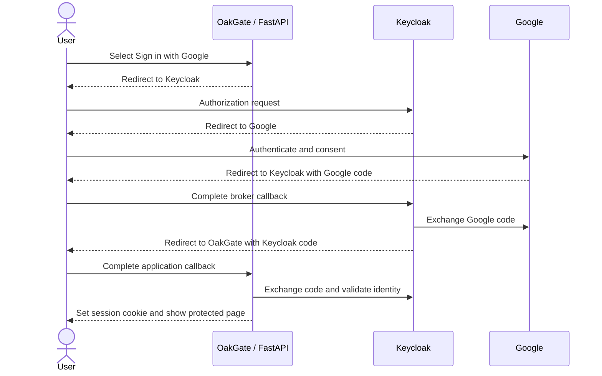

# OakGate authentication design

Status: Draft proposal  
Date: 2026-10-17

## Purpose

OakGate (OpenID Access Gate) is an application in the Mainstay family. Its first milestone is a working FastAPI application where a user can sign in with Google through Keycloak, view a protected page, and sign out.

OakGate’s product direction is a custodial application around safebox-acorn. The [Go Independent design note](004-go-independent.md) records the requirement to support independent recovery and ending custody; that workflow is deferred but must inform identity and storage choices.

The first implementation and exact client settings are documented in [Connect OakGate sign-in](005-keycloak-sign-in.md). This original design includes future capabilities beyond that initial slice.

FastAPI, Keycloak, and Google sign-in are confirmed requirements. The browser interface, session storage, and deployment choices below are proposed starting points.

## Architecture

FastAPI serves the application and owns its application sessions. Keycloak is OakGate's OpenID Connect (OIDC) provider and brokers authentication to Google. OakGate trusts identities issued by its configured Keycloak realm.

There are two separate OAuth clients: OakGate is a client of Keycloak; Keycloak is a client of Google. Google credentials belong in Keycloak configuration. The FastAPI service needs only its Keycloak client credentials. See the [Keycloak identity brokering documentation](https://www.keycloak.org/docs/latest/server_admin/index.html#_identity_broker).

## Proposed application model

Start with server-rendered pages and same-origin browser requests. Use an established OIDC client library, with Authlib as the candidate to evaluate during implementation. Use Authorization Code flow with PKCE (`S256`), state, and nonce. Disable implicit and password grants for the application client.

Keep tokens and temporary login transaction data on the server. Give the browser an opaque, random session identifier in a host-only, HttpOnly cookie with SameSite=Lax and Secure enabled in production. Do not put tokens in browser storage or in a readable signed session cookie.

Use Redis for expiring application sessions and login transactions. Rotate the session identifier after authentication. The current implementation uses a fixed one-week session by default, configurable through `OAKGATE_SESSION_TTL_SECONDS`; activity does not renew it. The ID token is validated at sign-in but does not cap the application session lifetime. Refresh tokens are not stored or used. Session-store outages fail closed.

## Application routes

| Route | Behavior |
| --- | --- |
| `GET /` | Public landing page with a Google sign-in button. |
| `GET /auth/login` | Create a short-lived login transaction and redirect to Keycloak. |
| `GET /auth/callback` | Validate the transaction, exchange the code, validate the ID token, and create a session. |
| `GET /account` | Protected page showing the user's name and email. |
| `GET /api/me` | Return a minimal user profile or HTTP 401. |
| `POST /auth/logout` | Validate CSRF protection, delete the local session, and initiate Keycloak logout. |
| `GET /health` | Basic liveness response without sensitive configuration. |

Use the Keycloak issuer and subject (`iss`, `sub`) as the identity key. Email is a display/contact attribute, not a durable identifier or permission grant. Authentication initially grants access only to the demonstration account page; future business permissions need explicit authorization checks.

## Provider configuration

Proposed development values:

| Setting | Value |
| --- | --- |
| OakGate origin | `http://localhost:8000` |
| Keycloak origin | `http://localhost:8080` |
| Realm | `oakgate` |
| Confidential client | `oakgate-web` |
| Application callback | `http://localhost:8000/auth/callback` |
| Post-logout redirect | `http://localhost:8000/` |
| Google provider alias | `google` |

Register exact redirect URLs. Use OIDC discovery from the configured realm issuer. Request `openid profile email`. The sign-in button can supply `kc_idp_hint=google` to select the broker.

Create a Google OAuth web application and configure its consent audience and test users as needed. Copy the redirect URI displayed by Keycloak into Google's authorized redirect URIs. With the values above it is expected to be `http://localhost:8080/realms/oakgate/broker/google/endpoint`; it is distinct from OakGate's callback. Verify the displayed URI during setup. Keep Google's client secret out of repository exports.

Retain proof-of-ownership checks when linking an existing account; matching email alone must not silently link accounts. Provider setup and first-login behavior are described in the [Keycloak administration guide](https://www.keycloak.org/docs/latest/server_admin/index.html#_google).

## Validation and session boundaries

The implementation must validate the ID token's signature, allowed algorithm, exact issuer, audience, expiry, nonce, and authorized party where applicable. Discover keys through the configured issuer and support key rotation. Consume login state once, enforce transaction expiry, and reject replay or mismatched state. Allow only local, approved destinations after login.

Protect all state-changing cookie-authenticated requests with CSRF validation. Avoid logging codes, tokens, cookies, or secrets. Return a useful retry page on denied consent or provider failure without creating an authenticated session.

Logout clears OakGate's session even if Keycloak is unavailable. Complete Keycloak logout using its discovered endpoint and an approved return URL. This does not promise to sign the user out of Google. Immediate propagation of administrator-triggered Keycloak logout to OakGate requires back-channel logout; defer that feature explicitly and document the resulting session-revocation delay before production.

This first version authenticates browser requests through the application session. A future externally consumed bearer-token API needs its own access-token audience and authorization design; ID tokens must not be used as API bearer credentials.

## Local development and deployment

Run FastAPI on the host initially. Use Docker Compose for Keycloak, its PostgreSQL database, and Redis. This makes `localhost:8080` reachable from both the browser and FastAPI and avoids inconsistent issuer URLs. Pin supported dependency and container versions during implementation.

Commit configuration templates with placeholders only. Keep real secrets in ignored local configuration or a deployment secret store. Use separate credentials and realms for development and production. Keycloak development mode and non-Secure cookies are permitted only for local HTTP development.

Production requires HTTPS, persistent Keycloak storage, protected Redis access, and explicit external hostnames. Trust forwarded headers only from the deployment proxy so generated redirects use the correct public scheme and host. See [FastAPI's proxy deployment guidance](https://fastapi.tiangolo.com/advanced/behind-a-proxy/).

## First implementation milestone

1. Scaffold FastAPI, templates, configuration, and local supporting services.
2. Configure the realm, application client, and Google broker using secret-free templates and a setup guide.
3. Implement login, callback validation, session handling, account page, and logout.
4. Test successful login, cancelled consent, invalid/replayed state, expired sessions, rejected token claims, refresh failure, CSRF rejection, and logout.
5. Verify a real Google login manually with development credentials; automated tests should use a controlled provider or mocked protocol responses.

## Open decisions

- Should access be open to any Google account, restricted to a Workspace domain, or invitation-only?
- Will production require immediate remote logout propagation, and which hosting environment will it use?

The initial local demonstration can proceed with the proposed browser architecture. Public deployment should wait until the admission policy is decided.
