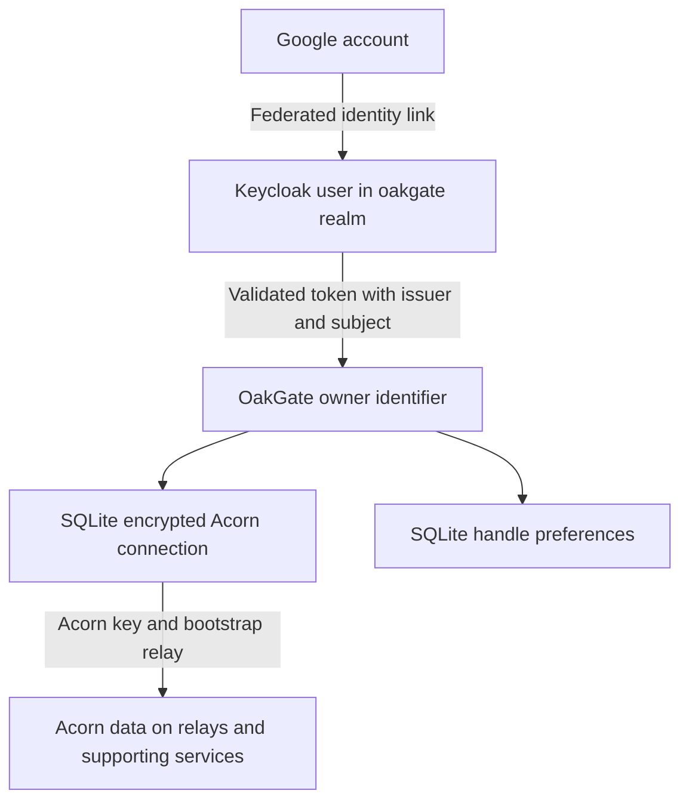

# Identity mapping storage and backups

Date: 2026-10-18  
Status: Current implementation and recovery design

OakGate connects a familiar Google login to a persistent Acorn through a Keycloak identity. SQLite preserves the custody relationship; Redis holds disposable sign-in state. Restoring access to the same Acorn requires preserving both the identity mapping and the encrypted recovery material, together with its encryption key.

## From Google login to Acorn



Google authenticates the user through Keycloak's Google identity provider. Keycloak maintains the link between that Google account and a user in its `oakgate` realm. OakGate receives a Keycloak identity token, not a Google token, and verifies its signature, issuer, audience, nonce, and lifetime.

Two token fields define the owner:

| Field | Meaning | Example |
| --- | --- | --- |
| `iss` | The exact Keycloak realm issuer | `https://keycloak.safebox.dev/realms/oakgate` |
| `sub` | The stable subject identifying a user within that realm | A Keycloak-assigned user identifier |

OakGate computes `owner` as SHA-256 of the compact JSON encoding of `[iss, sub]`. The same calculation identifies the user's wallet and preferences rows. The hash is an internal lookup identifier, not a password or an authentication mechanism. The encrypted wallet envelope also contains the owner identifier, which OakGate checks when decrypting the row.

The database permits one Acorn connection per owner. A separate unique hash of the Acorn's public key prevents the same Acorn from being connected to a second owner within this database. Public-key hashes and owner hashes are indexes; neither substitutes for the encrypted private key.

### What does not define ownership

An email address, display name, or custom OakGate handle does not identify the owner. Changing those values does not move the Acorn connection. A handle is a user preference, with case-insensitive uniqueness enforced separately in SQLite.

Another sign-in method can reach the same Acorn only if Keycloak authenticates it as the same realm user. Matching email addresses alone are not an OakGate account-linking rule. Identity-provider linking and recovery must remain controlled by Keycloak's configured flows.

Deleting and recreating a Keycloak user normally creates a different subject. Changing the realm's issuer URL changes the other half of the pair. Either change produces a different OakGate owner identifier, even if the person uses the same Google account afterward. OakGate currently has no automatic ownership migration or account-reassignment workflow. Do not repair an identity mismatch by matching email addresses or editing custody rows casually.

## SQLite holds durable application state

On the current Beelink deployment, `OAKGATE_DATA_DIR=/var/lib/oakgate` selects the internal SSD directory mounted at `/app/data`. The database is:

```text
/var/lib/oakgate/custody.sqlite3
```

| Table | Contents | Protection and constraints |
| --- | --- | --- |
| `wallets` | Owner index, Acorn public-key hash, encrypted custody material, setup status, and a short setup lease | One row per owner and one owner per Acorn public key; custody material encrypted with Fernet |
| `user_social_preferences` | Owner index and optional public social npub | NIP-05 association only; no private key or change to Acorn ownership |
| `user_preferences` | Owner index, display handle, and normalized handle | Unique normalized handle across the instance; handles stored as ordinary text |
| `lightning_handles` | Handles advertised for payments and their owners | Prevents reassignment of an advertised address to another user |
| `incoming_payments` | Receiving progress and encrypted quote, blinding secrets, proofs and signed delivery events | Durable mint and publication recovery; short processing leases; unique zap request IDs |

The encrypted material includes the `nsec`, recovery phrase, bootstrap relay, public identity, derivation mode, and initial wallet metadata for newly created Acorns. Saving creation material before relay publication lets a pending setup retry with the same identity and metadata after a restart.

`OAKGATE_CUSTODY_KEY` supplies the Fernet encryption key. It is not stored in the database. The database without the key cannot decrypt custody material; the key without the database cannot recreate the user-to-Acorn mapping. Encryption protects a copied database but does not prevent a running application or operator holding the key from accessing secrets.

SQLite is not a complete copy of each Acorn. Record contents, existing cash proofs, Clear proof state, and other Acorn state are read from relays or supporting services. Incoming payments additionally retain their own encrypted proofs and delivery events in the local payment journal; this is not a complete Acorn proof archive. OakGate's connection database is not a backup of those systems or of external mint state.

## Redis holds temporary authentication state

Redis is the private `sessions` Compose service. It has no published host port, persistence is disabled, and its `/data` directory uses temporary memory storage.

| Record | Purpose | Lifetime |
| --- | --- | --- |
| Login transaction | Holds the OAuth state, nonce, and PKCE verifier, bound to the browser's login cookie | Ten minutes; consumed once with atomic `GETDEL` |
| Application session | Holds the Keycloak issuer and subject, basic profile, CSRF token, and expiry | One week by default; fixed expiry configured with `OAKGATE_SESSION_TTL_SECONDS`, independent of token expiry after sign-in |

The browser holds a random session identifier in an HttpOnly cookie. The Redis lookup key hashes that identifier. Acorn keys and recovery phrases are not copied into sessions, and Keycloak access, refresh, and ID tokens are not retained in Redis.

Redis provides automatic expiry and shared session access across application processes. Its atomic transaction consumption prevents two callbacks from using the same sign-in attempt. Local development can use an in-memory store instead; restarting that development process loses its sessions.

Restarting only the app preserves unexpired Redis sessions. Restarting Redis invalidates sessions and unfinished logins, so users sign in again. It does not remove their Acorn connections or handles. A Redis outage fails closed for session access. Redis is deliberately excluded from durable backups; a restore should begin with fresh sign-in sessions.

## What must be backed up

| Component | What to preserve | Why it matters |
| --- | --- | --- |
| OakGate database | A consistent SQLite backup, including preferences, address reservations, pending setup rows, and the complete incoming payment journal | Preserves custody material, user associations, and handle claims |
| Custody encryption key | The exact `OAKGATE_CUSTODY_KEY` used by that backup | Required to decrypt wallet rows and payment recovery material |
| Keycloak persistence | A consistent backup of `/mnt/bitcoin/keycloak` for the current file-backed development deployment, with the matching Keycloak version recorded | Preserves users and their IDs, Google identity links, realm/client configuration, and associated secrets |
| Deployment configuration | Protected copies of required `.env` settings, Compose configuration, application revision, Poetry lockfile, and container versions | Restores the same issuer, client, storage paths, relay configuration, and compatible application |
| Google project administration | Recoverable administrative access and a record of OAuth client configuration and authorized redirects | The Google project and OAuth client are external dependencies; local database backups do not restore them |
| Proxy and DNS configuration | Nginx configuration and a way to restore DNS and TLS | Keeps the issuer and application origins reachable at their configured HTTPS addresses |
| Acorn infrastructure | Appropriate backups or replication for the relays, blob services, and other infrastructure you operate | Preserves the actual Acorn data beyond OakGate's local custody envelope |

Back up the custody key separately from the database, under access controls appropriate for secret material. The current `.env` contains that key and other credentials, so any configuration backup containing it is also a secret backup. Do not put these files in Git or an ordinary unencrypted archive. Keep backup copies off the same external drive so a single drive failure does not destroy both live data and its backups.

The Keycloak bootstrap administrator password alone is not a Keycloak backup. Recreating an empty realm and adding similarly named users does not preserve the original subjects or Google account links. If Keycloak later moves to an external database, that database becomes the primary persistence backup target; the current directory-based procedure must change accordingly.

## Taking consistent backups

For a simple coordinated backup, use a maintenance window: stop the OakGate app to prevent new custody, preference and payment writes, and stop Keycloak before copying its current file-backed data directory. Back up the closed SQLite database and stopped Keycloak directory, preserve the corresponding configuration and secrets, then restart the services. Redis does not need to be copied.

For an online SQLite backup, use SQLite's backup API rather than copying a live database file. A raw copy taken during writes can be inconsistent or omit journal state. An online backup plan also needs a supported, consistent Keycloak database backup procedure. Do not assume a filesystem copy or a configuration-only realm export captures the complete identity state.

Record the backup time and software versions. Keep identity and custody backups close in time: restoring a newer OakGate database with an older Keycloak snapshot can leave custody rows referring to users absent from that snapshot. A backup is useful only after its restore procedure has been tested.

## Restore and verify

1. Restore into an isolated environment first, using the recorded application and Keycloak versions. Keep public traffic disabled and set `OAKGATE_PAYMENTS_ENABLED=false` to prevent automated settlement during verification. Never run a restored copy alongside the live payment worker.
2. Restore the consistent OakGate database and the matching custody key. Restore Keycloak's users and federated identity links from its persistence backup, rather than recreating them manually.
3. Restore configuration and directory ownership. The current containers require the OakGate data directory writable by UID `10001`, and Keycloak's directory by its UID `1000`.
4. Preserve the exact configured Keycloak issuer and user subjects. An isolated restore can verify the database and identity data without changing them; plan routing and authorized redirects before an end-to-end login test.
5. Start Redis fresh and require sign-in again. Let short setup leases expire before retrying pending Acorn creation; do not generate replacement identities for pending rows.
6. Verify that the same Google login resolves to the same Keycloak subject and OakGate owner. Confirm the existing Acorn public identity and handle, then read balances and records from the intended relays without initiating payments.
7. Reconcile pending incoming payments against current mint and relay state before re-enabling the worker. A stale backup can omit invoices issued after that backup, including their random blinding secrets. See [Lightning receiving](009-lightning-receiving.md).
8. Verify a permitted independent recovery procedure with a disposable test Acorn, not by exposing a real user's recovery material. Re-enable ordinary service only after the identity and data checks succeed.

Losing Redis costs sessions. Losing the SQLite database, its encryption key, or the Keycloak identity mapping threatens durable recovery. Losing relay or supporting service data is a separate failure that restoring OakGate alone cannot solve.

## Recovery limits and future work

Google's recovery process can restore access to a Google account; it does not recreate OakGate's encrypted database or recover a lost custody key. Likewise, restoring OakGate cannot bypass Google's account-access decisions.

This note defines the backup requirements; it does not install a backup scheduler or establish that a full disaster-recovery restore has been tested. Retention, off-host storage, encryption-key rotation, controlled identity migration, and a rehearsed restore procedure remain operational work.

Future [Go Independent](004-go-independent.md) implementation must also account for backups. Restoring an older snapshot must not silently recreate a departed user's custody or handle claim. The existing design requires an explicit deletion and restore policy before promising that departure workflow.

Related notes: [Connect sign-in](005-keycloak-sign-in.md), [Acorn custody](007-acorn-custody.md), and [custody models](006-custody-models.md).

## Application identity backup

Preserve `OAKGATE_SERVICE_NSEC` securely with the configuration backup. Its public
npub is bound to the `service_identity` table in `custody.sqlite3`; keep the
matching database and secret together on restore. This is OakGate's zap-receipt
signer, separate from the custody encryption key and all user Acorn keys.

## Replacing the upstream sign-in provider

Google can be replaced through Keycloak while preserving the existing realm user and issuer. Verify an alternative login against that same identity before removing Google. A new user with the same email does not preserve custody ownership. Replacing Keycloak or changing its issuer requires a separate migration design; see [Mainstay principles and provider continuity](010-mainstay-principles.md#google-is-replaceable).


Record sharing and presentation codes are also encrypted with the custody key in
`custody.sqlite3` (`record_capabilities`). Include them in the consistent database
backup so users retain their Stop controls after restoration. Restoring an older
backup can restore already-deleted descriptors or omit newer copies; it cannot
restore a copy already removed from the external Blossom server. See
[Records and sharing](011-record-workflows.md).

See the [20 October storage latency incident](022-storage-latency-incident.md) for
the SSD migration evidence and stale-copy precautions. Back up the configured
active directory, not the old `/mnt/bitcoin/oakgate` copy.
