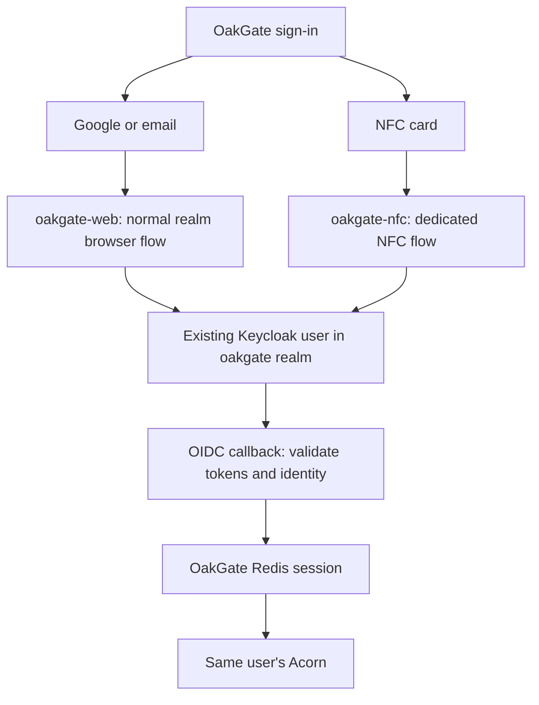

# Keycloak operations and sign-in flows

This guide consolidates OakGate's working Google, email and NFC sign-in setup.
It describes the implementation and the Beelink deployment, including the fixes
made during commissioning. Use it alongside the detailed
[NFC deployment guide](027-keycloak-nfc-login.md) and
[identity and backup design](008-identity-storage-backups.md).

## What Keycloak does

Keycloak authenticates people and issues OpenID Connect (OIDC) tokens. OakGate
validates those tokens and creates its own application session. Keycloak does
not store an Acorn's recovery phrase or operate the wallet. OakGate holds the
custody material, and user private-key operations go through safebox-acorn.

There is **one Keycloak service**, with two relevant realms:

- **master**: administration of Keycloak itself. Keep administrative access separate
  from ordinary OakGate user access.
- **oakgate**: application users, Google identity links, email configuration,
  registration and recovery, clients and authentication flows.

A realm is an identity/configuration boundary. A client is an application
registration within it. An identity provider supplies an upstream login, such as
Google. An authentication flow defines the steps Keycloak performs for a login.

| Component | Responsibility |
| --- | --- |
| Keycloak | Users, passwords, verification/recovery emails, Google links and OIDC authentication |
| Google | Optional upstream authentication; its own account recovery |
| Brevo | SMTP delivery of emails generated by Keycloak |
| OakGate | Custody, preferences, card enrollment and application sessions |
| Redis | Temporary OakGate sessions and short-lived authentication transactions |
| OakGate SQLite | Durable custody, payment recovery and card configuration |
| POS | Separate restricted terminal; its activation credential is not a Keycloak user login |

Google is replaceable, provided an alternative login reaches the **same existing
Keycloak user**. OakGate owns wallets by validated `(issuer, subject)`, not email,
handle, Google address or social npub. Deleting and recreating a user with the
same email produces a different identity and does not recover their Acorn.
Do not change the issuer or subject mapping casually.

## Which flow is used?



| User action | Client and behavior |
| --- | --- |
| Google sign-in | `oakgate-web`; Keycloak brokers Google authentication |
| Email/password sign-in | `oakgate-web`; Keycloak authenticates the local realm user |
| Registration and verification | Normal Keycloak registration and Verify Email steps |
| Forgotten password | Keycloak's normal reset-credentials flow and email delivery |
| Recovery disclosure, card-login activation/unlock or PIN-policy change | Fresh normal `oakgate-web` authentication, bound to the existing OakGate session and same identity |
| NFC login | `oakgate-nfc`; dedicated authenticator verifies an enrolled card through OakGate, then selects an existing realm user |

Fresh authentication requests `prompt=login` and `max_age=0`. Google still controls
its upstream session policy, so this does not promise a Google password prompt
on every occasion. NFC must never become the only route to account recovery.

## Addresses and clients

Admin console: <https://keycloak.safebox.dev/admin/master/console/>.
After entering, select **oakgate** before configuring application email, users,
clients or flows. Configuring SMTP in master alone does not configure oakgate.

| Setting | Value |
| --- | --- |
| Public Keycloak hostname | `https://keycloak.safebox.dev` |
| OIDC issuer | `https://keycloak.safebox.dev/realms/oakgate` |
| OakGate root/home URL | `https://oakgate.safebox.dev` |
| Exact valid redirect URI | `https://oakgate.safebox.dev/auth/callback` |
| Valid post-logout redirect URI | `https://oakgate.safebox.dev/` |
| Normal client | `oakgate-web` |
| NFC client | `oakgate-nfc` |

Both clients use OpenID Connect, **Client authentication ON**, **Standard flow ON**,
PKCE **S256**, and the ordinary `openid profile email` scopes. Disable implicit
flow, direct access grants and service accounts. Keep the standard subject
mapping and RS256 signing. Disable deprecated **Full scope allowed**; OakGate
needs no administrator roles. Never use wildcard redirect URIs.

Client secrets are under **Clients → client → Credentials**. If Credentials is
missing, first enable Client authentication and save. Each client has its own
secret. For Web origins, an exact `https://oakgate.safebox.dev` is sufficient;
the server-side code exchange does not require browser token-endpoint CORS.
Development callback entries, if needed on the normal client, must also be exact,
for example `http://127.0.0.1:8801/auth/callback`.

## Google login

In the Google Cloud `oakgate` project, configure the consent screen and a Web
application OAuth client. Add the redirect URI shown by Keycloak's Google identity
provider. With the alias `google`, it is:

```text
https://keycloak.safebox.dev/realms/oakgate/broker/google/endpoint
```

This is the Google-to-Keycloak callback, **not** OakGate's `/auth/callback`.
Authorized JavaScript origins are separate: they contain an origin only, with no
path. This server-side broker flow does not need a blank origin entry; remove
empty entries rather than submitting them.

In **oakgate → Identity providers → Google**, enter the Google client ID and
secret, enable the provider, and save. The downloaded Google JSON is a credential:
keep it out of Git. Its secret belongs in Keycloak, not in
`OAKGATE_OIDC_CLIENT_SECRET`. Review first-login/account-linking behavior before
changing it; an email match alone must not silently transfer custody ownership.

## Email registration and password recovery

Brevo delivers mail; Keycloak creates verification and reset links and enforces
those flows. Sending as `noreply@safebox.dev` does not create an inbox. Test messages
arrive at the recipient's existing mailbox, such as Gmail.

1. In Brevo, authenticate `safebox.dev` and verify the sender. Copy its exact DNS
   records into the DNS provider: root verification TXT, DKIM and DMARC. At Rebel,
   `@` represents the root. Keep unrelated existing TXT records.
2. Wait until domain authentication and sender checks are green. Use the values
   displayed by Brevo, rather than inventing DKIM targets or replacing an existing
   DMARC policy blindly.
3. In **oakgate → Realm settings → Email**, configure the From address/display name
   and SMTP server `smtp-relay.brevo.com`, authentication and the SMTP login/key
   supplied by Brevo. Use a matching encrypted port/mode, such as port **465 with
   SSL**, or **587 with StartTLS**. Do not enable both modes indiscriminately.
   An SMTP key is distinct from a Brevo API key.
4. Use **Test connection**, with a valid recipient email on the administrator
   account performing the test. Check that mailbox. A successful test was received
   during commissioning.
5. In **Realm settings → Login**, enable **User registration**, **Forgot password**
   and **Verify email**. Review email-as-username/login-with-email settings to match
   the intended account policy. Retain the standard registration/reset flows.
6. Test a new account in a private browser, complete verification, then separately
   test Forgot password and sign back in. Registration plus verification was tested
   successfully in Safari; card scanning has different browser requirements.

The [Keycloak administration guide](https://www.keycloak.org/docs/latest/server_admin/index.html)
and [Brevo SMTP guide](https://developers.brevo.com/docs/smtp-integration) are the
upstream references. Email settings are per realm; master can have its own SMTP
configuration for administrator recovery.

## NFC login: separate client, same account

The custom provider is packaged into the existing Keycloak image using
`compose.nfc.yaml`. It adds no second Keycloak instance, realm or database.

In **Authentication → Flows**, create a basic `oakgate-nfc` flow with exactly one
execution: **OakGate NFC card and PIN**, set to **REQUIRED**. Under
**Clients → oakgate-nfc → Advanced → Authentication flow overrides** (near the
bottom), select that flow for Browser flow. Leave the realm browser binding and
`oakgate-web` unchanged. Do not add Cookie, password or Google alternatives inside
the NFC flow: normal sign-in remains a separate choice.

The holder opts in during card issuance, saves the generated four-digit PIN,
and completes card write/readback. Enrollment is still pending until the holder
uses **Preferences → Your NFC cards → Verify sign-in and save** and completes
fresh normal sign-in. Existing cards without the required PIN/enrollment need
reissuance. The PIN verifier is stored server-side; the PIN is not written onto
the card or given to the POS.

At login, Web NFC reads the card in a compatible HTTPS browser. Keycloak sends
it, the PIN and a short-lived challenge to OakGate's authenticated internal
verification endpoint. OakGate checks card validity, issuer identity, enrollment,
wallet binding, revocation, expiry and PIN policy. Keycloak accepts only the
returned existing, enabled user in its realm. The subsequent OIDC callback creates
the ordinary OakGate session; the card never creates a session directly.

PIN checking defaults on. A holder can explicitly select card-only login after
acknowledging the risk and completing fresh normal authentication. That exception
is server-side and per card, not a global `.env` bypass. Five wrong PIN attempts
lock card login; successful logins do not reset that counter. Fresh normal
reauthentication can unlock it; a forgotten PIN requires reissuance.

Web NFC is available on supported Android/Chrome devices, not Safari/iPhone.
Card plus PIN is not equivalent to a FIDO2 security key: a copied card and known
PIN can authenticate. With PIN disabled, the copied credential alone is enough.
Withdrawing enrollment stops new logins; revoking the card also stops its other
capabilities. Neither action terminates sessions already issued.

See [the NFC guide](027-keycloak-nfc-login.md) for deployment, rollback and failure
handling, and [card/payment design](026-nfc-card-payments.md) for the separate
payment permissions. Login enrollment does not expand POS permissions.

## Configuration and secrets: where each belongs

| Location | Configuration |
| --- | --- |
| Tracked Compose files | Services, health checks, required volume variables and optional NFC image override |
| Private deployment `.env` | Host paths, public URLs, feature flags and application/server secrets |
| Keycloak persistent database | Users, passwords, Google links, clients/secrets, SMTP settings and flows |
| Google/Brevo consoles | OAuth consent/client settings, sender/domain configuration and SMTP credentials |
| OakGate database | Card enrollment/PIN policy, custody and preferences |

Relevant `.env` values for Beelink:

```dotenv
KEYCLOAK_DATA_DIR=/mnt/lexar/keycloak
OAKGATE_DATA_DIR=/mnt/lexar/oakgate
KC_HOSTNAME=https://keycloak.safebox.dev
KEYCLOAK_BIND_ADDRESS=0.0.0.0
KEYCLOAK_PORT=8800
OAKGATE_PUBLIC_URL=https://oakgate.safebox.dev
OAKGATE_OIDC_ISSUER=https://keycloak.safebox.dev/realms/oakgate
OAKGATE_OIDC_CLIENT_ID=oakgate-web
OAKGATE_OIDC_CLIENT_SECRET=<normal client's secret>
OAKGATE_SESSION_TTL_SECONDS=604800
COMPOSE_FILE=compose.yaml:compose.nfc.yaml
OAKGATE_NFC_LOGIN_ENABLED=true
OAKGATE_NFC_CLIENT_ID=oakgate-nfc
OAKGATE_NFC_CLIENT_SECRET=<NFC client's separate secret>
OAKGATE_NFC_BACKCHANNEL_SECRET=<output of openssl rand -hex 32>
```

These are selected settings, not a replacement for the complete existing `.env`.
Preserve custody, service identity, POS and other keys. Protect `.env` with mode
600 and keep it out of Git. Generate the backchannel secret once; it authenticates
Keycloak to OakGate and must match in both containers. It is never a user PIN or
browser credential. `KC_BOOTSTRAP_ADMIN_PASSWORD` bootstraps initial administration;
changing it is not a password-reset mechanism for an existing administrator.

`COMPOSE_FILE` is essential while NFC is enabled: future refreshes must keep the
custom image. An app-only refresh does not rebuild the Keycloak plugin. Keep
storage paths in `.env`, not local edits to tracked Compose files that may be
lost during stash/pull operations.

## HTTPS and the internal connection

Nginx terminates public HTTPS and forwards to Keycloak's internal HTTP port 8800.
The Compose configuration sets `KC_PROXY_HEADERS=xforwarded`, a strict public
hostname, and HTTP enabled for this backend hop. In the HTTPS proxy location,
set each forwarded header once:

```nginx
proxy_set_header Host $host;
proxy_set_header X-Forwarded-Host $host;
proxy_set_header X-Forwarded-Proto https;
proxy_set_header X-Forwarded-Port 443;
proxy_set_header X-Forwarded-For $remote_addr;
proxy_pass http://100.70.55.66:8800;
```

That upstream is the Beelink VPN address used in this deployment; use loopback
only when Nginx runs on the same host. Restrict backend access to the trusted
proxy/network, especially with `0.0.0.0` binding. Missing HTTPS forwarding caused
the earlier non-secure-cookie warnings and authentication failures.

The NFC backchannel is a different hop:
`http://app:8000/api/cards/v1/login/verify` inside Compose. It uses the shared
secret and explicitly **HTTP/1.1**. Java's attempted cleartext HTTP/2 upgrade
caused an empty request body in the tested Uvicorn path, producing OakGate
`JSONDecodeError` and Keycloak `phase=backchannel http_status=400`. Forcing HTTP/1.1
on the Java client and request resolved the reproduced failure, followed by a
successful live login. This is not a reason to disable browser-facing HTTPS or
HTTP/2 on Nginx. Separate-host backchannels require HTTPS.

## Sessions and recovery boundaries

OakGate's session cookie is an opaque reference to Redis state: HttpOnly, Secure
on HTTPS and SameSite=Lax. The default lifetime is a fixed week, not sliding.
OakGate does not retain refresh tokens. Keycloak SSO/client session settings are
separate; adjust those in Keycloak deliberately rather than assuming the OakGate
TTL changes them.

Redis restart logs users out but does not delete their accounts or wallets.
App restart preserves sessions while Redis remains running. Authentication state
is short-lived, browser-bound and consumed once. Recovery and card-policy changes
require fresh authentication despite an existing application session.

Keycloak backchannel logout is not implemented for OakGate sessions. Disabling a
user or withdrawing card login does not immediately invalidate an existing
OakGate session. Account-compromise response must consider both session stores;
a Redis restart is a broad logout of everyone, not a targeted recovery tool.

## Updating and verifying the deployment

From the OakGate deployment directory, first check the mount and configuration:

```sh
mountpoint /mnt/lexar
docker compose config --quiet
```

Use `./refresh-app.sh` for app updates; it waits for app health and leaves
Keycloak/Redis running. When the NFC provider changes, rebuild the existing
Keycloak service on Beelink:

```sh
docker compose up -d --build --no-deps keycloak
docker compose ps keycloak
docker compose logs --since=2m --tail=80 keycloak
```

Wait for healthy status before testing login. A plain restart does not apply
changed container environment. `./refresh-containers.sh` refreshes the broader
deployment with a bounded readiness wait; retain the NFC Compose override.
Keycloak startup can take tens of seconds and briefly use substantial CPU.
Its readiness endpoint is internal port 9000, not a public management port.

After a change:

- [ ] Both application and Keycloak use their intended `/mnt/lexar/...` directories.
- [ ] App, Keycloak and Redis report healthy.
- [ ] Admin access and existing Google/email sign-in still work.
- [ ] Both methods reach the same expected wallet and preferences.
- [ ] Email verification/reset delivery works when those settings changed.
- [ ] NFC login works for an enrolled card on a compatible device.
- [ ] A non-enrolled/revoked card is refused; test PIN lockout only with a test card.
- [ ] Normal login remains available for card loss or unsupported browsers.

The current Compose command is `start-dev` with file-backed H2. The development
mode warning is accurate: HTTPS and successful tests do not turn this into a
production-hardened Keycloak deployment. Moving to production mode and a supported
production database requires the separate [PostgreSQL migration checklist](034-keycloak-postgresql.md). Its opt-in override is prepared; the actual migration must be rehearsed and explicitly performed.

## Troubleshooting quick reference

| Symptom | Check |
| --- | --- |
| No NFC execution under Add execution | NFC Compose override is loaded and custom Keycloak image was built/recreated |
| Credentials tab missing | Client authentication is enabled and saved |
| Authentication flow overrides hard to find | NFC client's Advanced tab, near the bottom |
| Non-secure-cookie warning | Public hostname and Nginx forwarded HTTPS/host/port headers |
| SMTP test works only for admin realm | Configure Email in oakgate as well as master |
| NFC rejected, `JSONDecodeError`, backchannel 400 | Updated HTTP/1.1 provider deployed; inspect phase logs, never credential bodies |
| Card login denied but normal login works | Enrollment, activation, card/PIN policy, lockout and user enabled status |
| Login works but wrong/new wallet identity | Check issuer and subject continuity; do not repair by matching email |
| App healthy but login unavailable | Health is not an end-to-end OIDC, Google or SMTP test |

## Backups and continuity

Back up the **active** Keycloak data directory consistently, with Keycloak stopped
for the current file-backed H2 deployment. Preserve its version and matching NFC
provider source/image. A realm export alone is not the complete recovery plan.

Also preserve a consistent OakGate database backup, custody/service keys and private
configuration. Card data includes encrypted credentials/identity bindings, PIN
verifiers and policy; losing or rolling back that state affects authentication and
revocation. The Keycloak backup must preserve user IDs and identity links. Never
run an old restored payment database concurrently with the live instance.

Redis is deliberately ephemeral and need not be restored to recover wallets.
Keep protected backups on a separate device: moving all active services to Lexar
improves latency but does not itself create a backup. See the
[backup inventory and restore constraints](008-identity-storage-backups.md).
