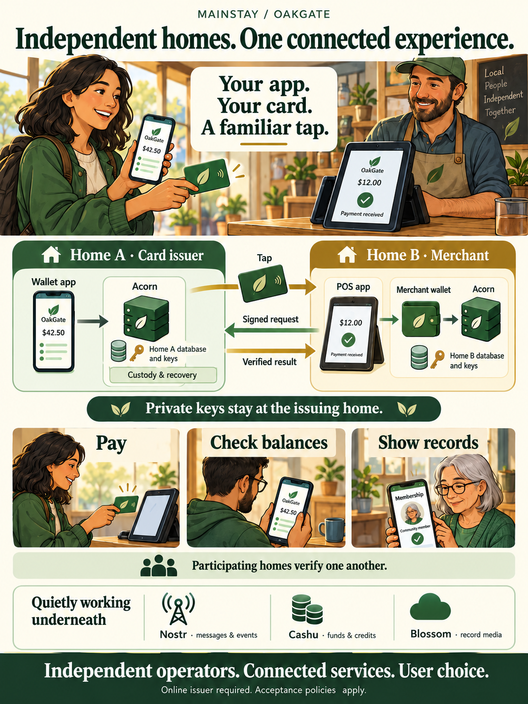

# Cards and POS terminals across OakGate homes

[](assets/user-experiences/connected-homes.png){ .oakgate-experience-image }

[Read the illustrated user experience](user-experiences/connected-homes.md)


OakGate supports both sides of a cross-home interaction:

- **A local POS can read a foreign card.** Its home forwards the requested operation to the card's issuing home.
- **A local home can serve a foreign POS.** It verifies a signed request from that POS's home and performs the permitted operation for its own card holder.

“Foreign” simply means issued or operated by another independent OakGate home.
It does not mean unverified. Each home authenticates the other service, and the
issuing home decides whether to accept the request.

The card is a reference to a wallet, not a wallet on plastic. The POS reads its
credential; the issuing home resolves it to the holder's Acorn. Private keys and
custody material remain at that issuing home throughout the interaction.

## Example: a community member visits another merchant

Maya has an OakGate wallet at Home A and a card issued there. A merchant uses a
POS activated with Home B. Maya does not need an account at Home B or a new card.

The merchant creates a payment request on its POS. Maya taps her card. Home B
reads the issuer address and pinned service public key from the card, verifies
Home A, and sends it a signed payment instruction. Home A validates the card and
request, then uses Maya's Acorn to pay the merchant's invoice or Clear request.
The POS follows its existing receipt polling to show detection or receipt.

The same arrangement supports a confirmed balance lookup or a request to show
an allowed record category. For example, a `member` record could be presented at
a participating venue that operates its own OakGate home. Multiple matching
records appear in the POS selector; one matching record retains the simple flow.

This does not mean every Community Credit is accepted everywhere. The selected
mint, unit, available balance and existing payment policies still determine
whether a particular payment can succeed.

## The request path

```text
Card issued by Home A
        |
        | NFC tap: issuer address, pinned service key, opaque credential
        v
POS activated with Home B
        |
        | Existing authenticated, device-signed terminal API
        v
Home B — acquiring home
        |
        | Signed operation over HTTPS
        v
Home A — issuing home
        |
        | Validate card and policy; use Acorn for wallet operations
        v
Signed result → Home B → POS
```

Home B never decrypts Home A's card credential. Home A never receives Home B's
terminal session cookie or device private key. The browser does not gain a session
in Home A, and the POS does not switch its configured API server for each card.

The homes can exchange roles on another transaction. Home A can acquire a card
issued by Home B, provided Home B's policy permits Home A. Acceptance is directional:
allowing B at A does not automatically configure A's acceptance at B.

## Identity, routing and authorization

The `OGC2` card contains the issuer's HTTPS origin and pinned service npub, plus
an authenticated encrypted credential. The **public key identifies the issuer**;
the **domain supplies its current contact address**. They have different roles.

The acquiring home checks that the issuer's `/info` publishes the pinned key
before forwarding the credential. It verifies the signed response against that
same pin and binds the response to the exact request. A changed issuer key is
rejected. The current implementation also requires the encoded origin to match
the issuer's configured origin; automatic domain relocation or key rotation is
not implemented. Preserve the existing identity and routing or plan card reissuance.

The issuing home checks the acquiring home's HTTPS-published service identity,
request signature, freshness and optional allowlist. It validates its own issuer
pin, card activation, expiry, revocation and current wallet binding. It does not
accept a claimed domain or arbitrary self-signed key as sufficient authentication.

A foreign POS is therefore accepted **through its home**, not independently
registered as a terminal in the issuing home's database. The acquiring home
verifies its terminal's authorization and signs the forwarded request. The
issuer trusts that accepted home to represent the terminal. The terminal name
is a claim made by that home, not independent proof of a merchant's legal identity.

No NIP-05 social npub is used to identify the card issuer or choose a wallet.
Existing wallet discovery and Acorn payment rules remain in effect underneath.

## Supported operations and limits

| Operation | Cross-home behavior |
| --- | --- |
| Pay by NFC | Issuer pays the merchant's exact stored Lightning invoice or Clear request through Acorn. No PIN prompt in the current POS policy. |
| Available Balance | Issuer returns Everyday Funds, a local-currency estimate when available, and Community Credits after the POS disclosure confirmation. |
| Check a Record | Issuer supplies an approved category's record choices and selected presentation, with attachment/PDF previews and OpenETR information. |
| Pay to a card from the wallet | Existing signed recipient resolution identifies the receiving Acorn; the payer reviews and confirms spending from their own wallet. |
| Issue a card | Remains home-local, including wallet approval and PIN disclosure. |
| QR wallet approval for a record request | Remains home-local; this extension federates the NFC path. |
| Card login | Remains with the issuing home's configured Keycloak flow. Federation grants no foreign account login. |

Record categories are `whoami`, `myinfo`, `emergency`, `health`, `benefits`,
`member` and `pass`. Matching is case-insensitive and includes the exact label
and slash-separated descendants. A maximum of 20 matches is allowed. Sessions
retain the original two-minute deadline; choosing another record does not extend it.
The issuer rechecks card authority before disclosure. Remote presentation receipts
are generated in the holder's wallet and identify the acquiring home and terminal.
Emergency-contact messaging also remains at the issuing home.

## Independent homes, not a shared account system

Federation connects independent homes. It does not merge their users, receipt
handles, databases, Keycloak realms or custody encryption keys. Each home maintains
its own authority and recovery responsibilities. A visitor does not become a local
user merely by tapping a card.

A [satellite](037-home-and-satellite-instances.md) is different: it extends one
home's presence and user population. A separate POS service connected to the same
home is also not a foreign home. Cross-home card support is implemented; it should
not be read as a claim that every planned satellite feature is implemented.

## Trust and holder agency

The card holder can revoke the card through their issuing home. That home remains
the authority for the card's wallet binding and permitted operations. Federation
does not transfer custody or the Acorn recovery material to a merchant's home.
The wider [Go Independent commitment](004-go-independent.md) remains unchanged.

These inexpensive cards are copyable bearer credentials. Encryption protects the
credential's contents, but not against copying the whole tag. Under the current
no-PIN POS policy, a valid copy can authorize a payment or disclosure through an
accepted home. Issuing a PIN does not protect an operation that does not check it.
Service signatures establish which home submitted an instruction; they do not
prove physical possession of the original tag or independent holder consent.

An empty `OAKGATE_CARD_TRUSTED_INSTANCES` permits verified signing homes. Setting
it to a list of service npubs limits which homes the issuer accepts for recipient
resolution and remote POS operations. This is an issuer-side access policy, not
a guarantee about a merchant's conduct. The receiving home can retain records or
balances it sees; clearing the POS display cannot erase another party's knowledge.
See [the NFC trust discussion](029-nfc-card-trust.md) for loss and revocation.

## Payments, interruptions and recovery

Both homes keep durable payment-attempt state. The acquiring home binds one
receipt to one card and instruction before contacting the issuer. The issuer
claims the attempt before preparation and records its outgoing payment ID before
sending. Repeated or concurrent requests inspect the original attempt instead
of initiating another send. Changing cards does not bypass the original receipt hold.

After an uncertain response, the acquiring home requests status. Missing status,
a timeout or a crash is not proof of nonpayment and does not authorize an automatic
resend. The existing SendService and Acorn transaction history remain the source
for reconciliation. Do not pay the same request by QR and card simultaneously.
A successful sending result is distinct from final receipt/redemption; the
merchant's receipt polling continues to report the receiving side's progress.

The issuer is online for every operation. Federation does not add offline payments
or an independent copy of the holder's wallet. An unreachable issuer results in
an unavailable/uncertain operation, not a fallback to another identity or payment route.

## Deployment checklist

- Deploy the updated **app and pos** services on both homes. No new database
  migration, card format or shared secret is required for this extension.
- Enable POS at both homes. Preserve each home's own service identity and NFC
  issuer data; do not copy service private keys between independent homes.
- Make each home's `/info` and `/api/cards/v1/pos` reachable over public HTTPS.
  The transport rejects redirects, private DNS targets and nonstandard ports.
- If using `OAKGATE_CARD_TRUSTED_INSTANCES`, configure the permitted acquiring
  service npubs on each issuer. Configure both directions if both are wanted.
- Keep clocks synchronized for signed-request freshness checks.
- Keep ordinary mint, relay, record-storage and Lightning connectivity working.
  Federation uses these existing services; it does not replace them.

No terminal reactivation or `OGC2` card rewrite is required. Older `OGC1` cards
lack the issuer pin and must be reissued. A home running an older release without
the endpoint cannot serve these operations; the acquiring home fails closed.

## Acceptance checks before relying on a deployment

Use two independent homes with different service keys and a disposable test card.
First issue at A and use B's POS; then reverse the roles if both directions are needed.

1. Confirm balances and friendly Community Credit units without creating a user
   account at the acquiring home.
2. Pay a small Lightning request and a compatible Clear request. Check both
   Acorn histories and the merchant's receiving status.
3. Check one record, a category containing several records, and a PDF with OpenETR
   information. Confirm the holder's presentation receipt identifies the remote home.
4. Repeat a request/status lookup and confirm there is no second debit. Exercise
   an interrupted response in a controlled test and reconcile the original attempt.
5. Revoke the test card and verify subsequent operations fail. Check that an
   excluded acquiring service and a mismatched issuer pin are rejected.
6. Close or replace a record request and verify stale results do not reappear.

Automated tests use independent stores and service identities with simulated
transport, including duplicate requests and disconnect recovery. Physical NFC,
public DNS/TLS, proxy configuration and live settlement still require deployment
acceptance checks. The implementation is not a claim that every pair of deployed
homes has already passed them.

For exact messages, endpoint limits and journal behavior, see
[the federated POS protocol](026-nfc-card-payments.md#federated-pos-card-operations).
