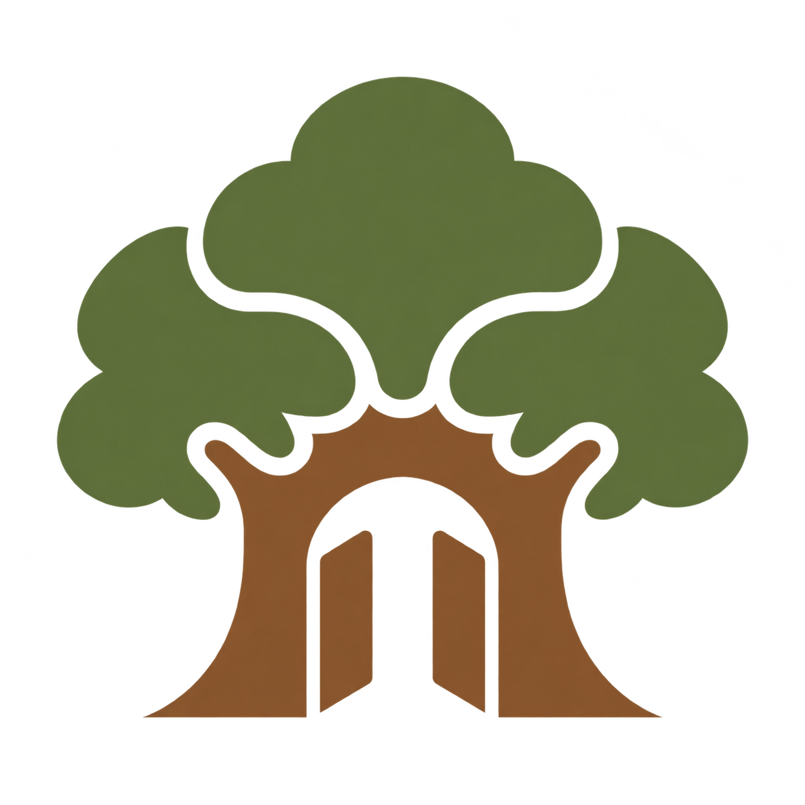

<section class="oakgate-hero" markdown>

PART OF THE MAINSTAY FAMILY

# OakGate

A welcoming way into your safebox.

A custodial app built around safebox-acorn. Familiar sign-in, recovery kept close, and a path to independence when you choose.

[Get started](getting-started.md){ .md-button .md-button--primary }
[Explore the direction](product-direction.md){ .md-button }

</section>

!!! note "Early development"
    The FastAPI app and Keycloak deployment are in place. App sign-in is implemented and needs the [Keycloak client setup](005-keycloak-sign-in.md). Custodial storage and Go Independent remain planned features.

## Managed by default. Independent by choice.

OakGate is being designed for people who want to use their safebox without managing keys and relay settings in everyday life. It will hold the information needed to operate and recover their safebox, and make that information available when they ask.

<article class="oakgate-card" markdown>

### A familiar entrance

Sign in through Keycloak, with Google as the intended first identity provider. Keep the everyday experience approachable.

[Authentication design →](001-authentication-design.md)

</article>

<article class="oakgate-card" markdown>

### Recovery kept close

Retain the keys, recovery phrase, bootstrap relay, and additional information needed to recover the same safebox independently.

[The custodial model →](product-direction.md)

</article>

<article class="oakgate-card" markdown>

### Go Independent

Recover your safebox outside OakGate, then end the relationship and request deletion of the information OakGate holds about you.

[Read the design note →](004-go-independent.md)

</article>

<section class="oakgate-independence" markdown>

## Take it from here.

**Go Independent** is a design commitment: prepare the user to operate on their own before ending custody. The safebox remains intact. OakGate must explain what it deletes, what may remain temporarily, and why deletion cannot be independently proven.

[Understand Go Independent](004-go-independent.md){ .md-button }

</section>

## One family, different responsibilities

OakGate adds a managed experience around Acorn's capabilities. Safebox Web represents the approach where the application does not retain the user's `nsec`; OakGate intentionally takes on that custody. These are different choices about responsibility, not interchangeable interfaces.

[**Mainstay** — the product family](https://trbouma.github.io/mainstay/)

[**Acorn** — safebox capabilities](https://trbouma.github.io/safebox-acorn/)

[**Safebox Web** — a different custody model](https://trbouma.github.io/safebox-web/)

## Start with what works today

Run the FastAPI app locally with Poetry, or deploy its container alongside Keycloak on your own server. Containers are built on the deployment machine.

[Local development](003-fastapi-app.md){ .md-button }
[Deployment guide](002-keycloak-beelink.md){ .md-button }
[Project status](project-status.md){ .md-button }
