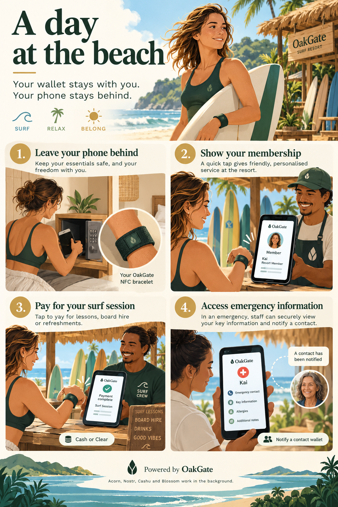

# A day at the beach without a phone

[](../assets/user-experiences/a-day-at-the-beach.png){ .oakgate-experience-image }

[Open the full-size infographic](../assets/user-experiences/a-day-at-the-beach.png){ .md-button }

*An illustrative resort story and bracelet concept, not product screenshots or a
waterproof hardware specification. “Notified” in the illustration means a message
published to a wallet relay; it does not confirm that the contact has read it.*

## Ready before leaving the room

Kai is heading to the beach for a surfing expedition. Her phone stays in the room.
Earlier, she paired her OakGate wallet with the resort's terminal and approved an
NFC credential written into a neoprene bracelet. The bracelet works like her card:
it gives the terminal a way to reach her wallet, without storing her wallet's private
key or her records on the bracelet.

Her wallet has Everyday Funds for purchases and the resort's supported Community Credits. She
has also prepared a **whoami** record with her photo and resort membership, and an
**emergency** record containing information she chooses to make available.

## A tap to show membership

At the surf desk, the attendant opens **Check a Record**, selects **whoami** and
creates a request. Kai taps her bracelet. The attendant selects **Show Record**
and sees the membership record and its original image. Where an attached artifact
has OpenETR information, the terminal shows that verification information too.
The resort decides whether the evidence satisfies its membership policy.

The record remains in Kai's Acorn. The terminal displays a temporary presentation;
it does not import the record into the resort's wallet. A new request or **Stop
Request** removes the display, and the request expires after two minutes.

## A second tap to pay

The attendant switches to **Point of Sale**, enters the amount and selects Cash for Everyday Funds
or the appropriate Community Credits asset using its friendly name. Kai taps to pay for the surf session. The
terminal follows the payment through its existing receipt flow; a detected payment
and a finalized credit are different states. Her phone is still in the room.

## Emergency information when it is needed

If Kai needs help, staff can request **emergency** and read her bracelet with the
same terminal. Her record includes a separate line such as:

```text
contact:alex@wallet.example
```

When the terminal acquires the emergency presentation, OakGate attempts to send
Alex an inter-wallet message from Kai's Acorn saying that her emergency record was
accessed, with the time and a request reference. The message does not contain her
medical information or an attachment. It is an access notice, not a diagnosis or
confirmation that an emergency occurred. No email is sent.

The contact address can also be a NIP-05 social address, but it must support Safebox
wallet discovery: delivery resolves the Acorn key and relays through `safebox.json`,
not the social public key. A NIP-05-only address is not sufficient.

The terminal reports whether publication was confirmed. A contact may be offline
or may not read the message. Staff must use their normal emergency procedures;
this notification is not an emergency dispatch service.

## A small object, a connected wallet

Kai experiences a bracelet, a tap and a clear screen. Acorn handles wallet and
record operations; Nostr relays carry wallet messages, Cashu supports funds and
Blossom supplies record attachments quietly in the background. The staff terminal
and services need connectivity; the bracelet does not run an offline wallet.

The current flow uses activated same-home cards and compatible Android NFC
browsers. Record access does not ask for a PIN, including emergency access.
Anyone possessing the bracelet may be able to present these designated records
at an authorized terminal, so Kai chooses carefully what she puts there. She can
revoke the credential from her wallet if it is lost. Neoprene is a form-factor
concept: the chosen tag and enclosure must be tested for the intended water exposure.

See [POS record requests](../038-pos-record-requests.md) for setup, notification
limits and the supported record labels.

*Terminology: Everyday Funds means Cash; Community Credits means Clear balances. Some illustrations and payment controls retain Cash/Clear. See [user-facing language](../product-direction.md#user-facing-language).*
