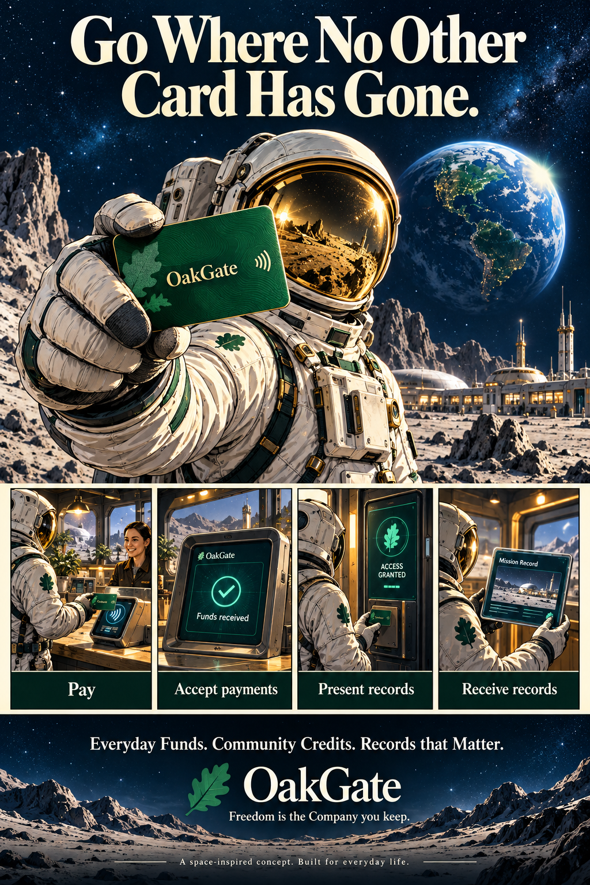
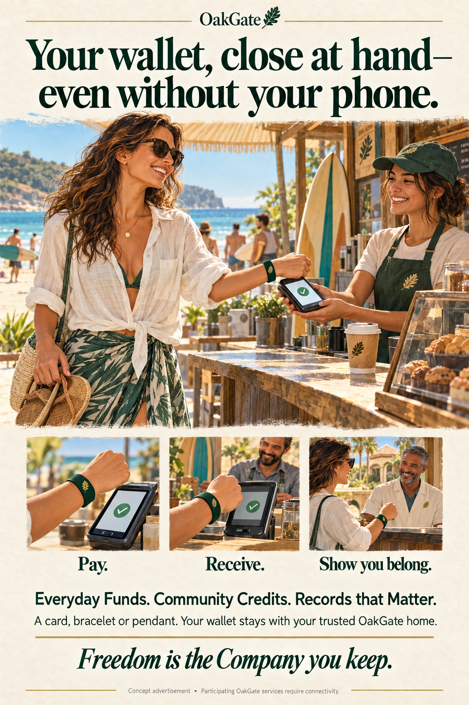

# Ad examples

## Go Where No Other Card Has Gone.

{ .oakgate-experience-image }

[Open the full-size ad](../assets/advertising/oakgate-space-exploration-ad.png){ .md-button .md-button--primary }

**One small card. A whole new world of possibilities.**

Pay for the next adventure. Accept funds along the way. Show a record that opens
a door. Receive a new record for the journey ahead.

An OakGate card brings all four experiences together through a connected wallet:
**pay, accept payments, present records and receive records.** Everyday Funds,
Community Credits and Records that Matter—close at hand and safe at home.

The astronaut takes that idea somewhere playful. Here on Earth, the same card
can pay at a market, receive community credits, show a membership and receive a
record shared by another wallet. The trusted OakGate home holds the funds and
records; the card gives access to the supported operations through connected,
participating apps and terminals.

**Freedom is the Company you keep.**

*A space-inspired concept, built for everyday life. The headline is imaginative
campaign language, not a historical claim about every card ever made or a claim
of space deployment. Generated artwork is a concept mockup.*

[Explore card capabilities](../card-capabilities-policy-brief.md){ .md-button }
[See how connected homes work](connected-homes.md){ .md-button }

## Your wallet, close at hand

{ .oakgate-experience-image }

[Open the full-size ad](../assets/advertising/oakgate-close-at-hand-ad.png){ .md-button .md-button--primary }

**Your wallet, close at hand—even without your phone.**

A coffee after a swim. Community Credits received at the counter. A membership
record shown on the way to the beach. She leaves her phone behind and carries
access to her wallet on a simple NFC bracelet.

**Pay. Receive. Show you belong.**

The card, bracelet or pendant gives access to her Acorn through her trusted
OakGate home. Her funds and records are not stored on the wearable, and the
merchant’s terminal and participating services still need connectivity. Acceptance
depends on the participating home, supported funds and the record being requested.
She can revoke a lost credential through her wallet; possession of the wearable
is authority for the enabled card operations, so it deserves care.

**Everyday Funds. Community Credits. Records that Matter.**

**Freedom is the Company you keep.**

*An illustrated concept advertisement, not a claim of offline operation or
universal acceptance. Generated artwork and lettering are mockups; final print
production would use approved brand artwork and publication-specific specifications.*

[Read the beach experience](a-day-at-the-beach.md){ .md-button }
[How cards and homes work together](connected-homes.md){ .md-button }

## Everyday exchanges, stronger connections

{ .oakgate-experience-image }

[Open the full-size ad](../assets/advertising/oakgate-full-page-ad.png){ .md-button .md-button--primary }

*A concept advertisement in a full-page broadsheet style. This is a mockup, not a
published placement or a newspaper endorsement. Illustration and lettering were
created with image generation; final print production would use approved brand
artwork and publication-specific specifications.*

### The message

**Everyday Funds, Community Credits and Records that Matter**

Everyday exchanges. Stronger connections.
Funds, credits and records—with a network you trust.

**Freedom is the Company you keep.**

The concept puts a person and their community at the centre. OakGate supports
their everyday exchanges while the underlying technology stays in the background.
“Network” describes the people, organizations and infrastructure around that
experience; OakGate still uses a custodial model with a trusted home operator.

[Explore User Experiences](index.md){ .md-button }

[Compare OakGate with payment and ID cards](../card-capabilities-policy-brief.md){ .md-button }
