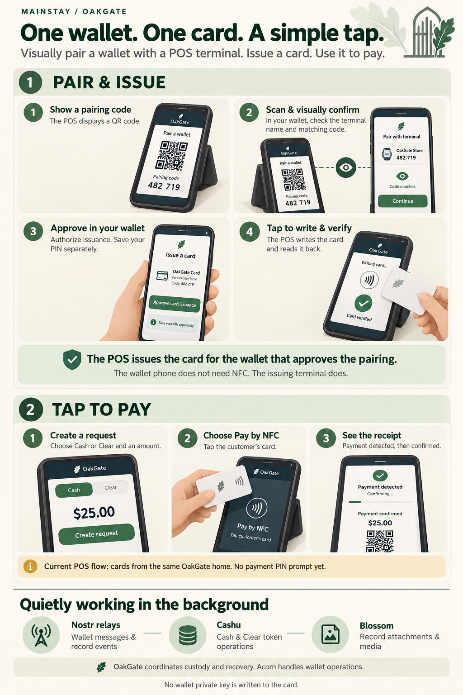

# From a wallet to a card

{ .oakgate-experience-image }

[Open the full-size infographic](../assets/user-experiences/card-pairing-and-payments.png){ .md-button }

*Illustrated screens explain the flow; they are not exact application screenshots.*

Maya visits a community café that uses OakGate. She already has a wallet with
funds, but would like a card she can tap at the counter. The café's POS and her
wallet belong to the same OakGate home.

## A pairing she can see

The staff member selects **Issue NFC card**. A QR code appears on the terminal,
along with a short pairing code. Maya scans it with her phone and opens the
pairing request in her signed-in wallet.

She checks the terminal's name and compares the code on her phone with the one
in front of her. They match. She selects **Approve card issuance** and saves her
new PIN separately when prompted.

The terminal now has approval to prepare a card for Maya's wallet. The staff
member presents a blank NFC card, writes it, and reads it back to verify the
result. Maya's phone never needs to write the card.

**The terminal supplies the NFC hardware. The wallet holder approves the pairing.**
The terminal operator does not need Maya's sign-in credentials or wallet private key.

## A payment with a tap

Later, Maya buys a drink. The staff member chooses Cash or the café's supported
Clear credits and enters the amount. Maya checks the amount displayed on the
terminal. The staff member selects **Pay by NFC**, and Maya taps her card.

The terminal shows the payment progressing. **Payment detected** tells the café
that a payment has been observed; it is distinct from final confirmation. The
wallet's transaction history provides a place to check the outcome later.

For this first version, payments do not prompt for a PIN. Maya keeps her card
safe and can revoke it from her wallet if it is lost. Card sign-in is a separate,
optional enrollment flow.

## A record with the same card

The café also hosts a community event. Maya has prepared a `whoami` record in
her wallet with a photo and the information she wants to show at the desk.
Her `myinfo` record contains additional information she chooses to present separately.

The staff member opens **Check a Record**, selects **whoami**, and chooses
**Create Request**. Maya can scan the QR with her wallet, check the terminal name
and requested label, then approve. With her card, the staff member instead chooses
**Request by NFC** and Maya taps it on the terminal.

Once the presentation is ready, the staff member selects **Present Record**.
The terminal displays the record text and its supported image attachment, so
Maya's photo can appear alongside her information. OpenETR verification information
is available for the attachment. Staff still need to assess what the record says;
a presentation alone does not prove identity or entitlement.

If additional information is needed, staff start a new request for **myinfo**.
Maya's previous record disappears from the display. **Stop Request** also removes
the display, and requests expire after two minutes. The record stays in Maya's
Acorn; it is not imported into the café's wallet.

NFC presentation currently uses the same-home card without a PIN. Maya therefore
puts only information she is comfortable presenting in these two records and
revokes a lost card promptly. QR presentation asks for approval in her wallet.

## Quietly in the background

Maya sees her wallet, a pairing code, a card and a payment indication. The
underlying services stay out of her everyday interaction:

- **Nostr relays** carry wallet messages and record events.
- **Cashu** supports the Cash and Clear token operations handled through Acorn.
- **Blossom** supports record attachments and media elsewhere in the experience;
  it is not a required step in every card issuance or payment.

OakGate coordinates custody and recovery. Acorn handles wallet operations,
including operations involving the user's private key. The card holds an
encrypted random credential—not the wallet private key. A Cash invoice remains
a Lightning payment; a Clear request follows the Clear payment flow.

## Available today

This flow requires an NFC-capable terminal and a supported secure browser, typically
Chrome on Android. The wallet holder's phone only needs to scan and approve the
pairing, so an iPhone can participate without writing the NFC card itself.

Current POS card payments accept cards from the same OakGate home. The paying
wallet must differ from the receiving wallet. Possession of a valid card currently
authorizes payment without a PIN: do not treat it as a tamper-resistant smartcard.
If a payment cannot be confirmed, check its status before trying another payment.

[Card provisioning and payment details](../025-pos-nfc-cards.md) ·
[Card trust and security](../029-nfc-card-trust.md) ·
[POS record presentation](../038-pos-record-requests.md) ·
[Explore User Experiences](index.md)
