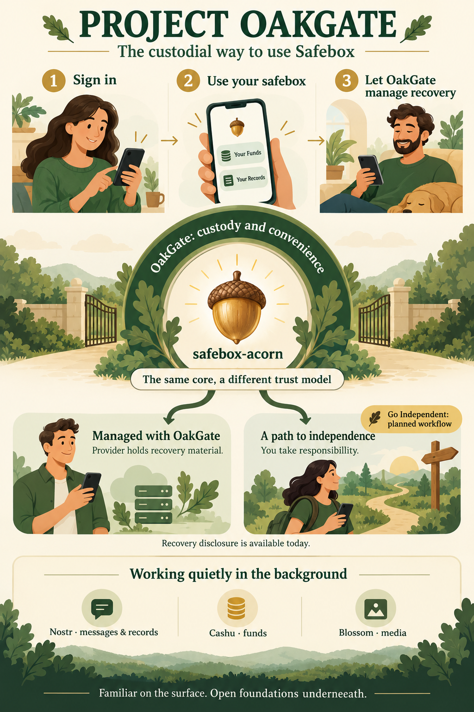
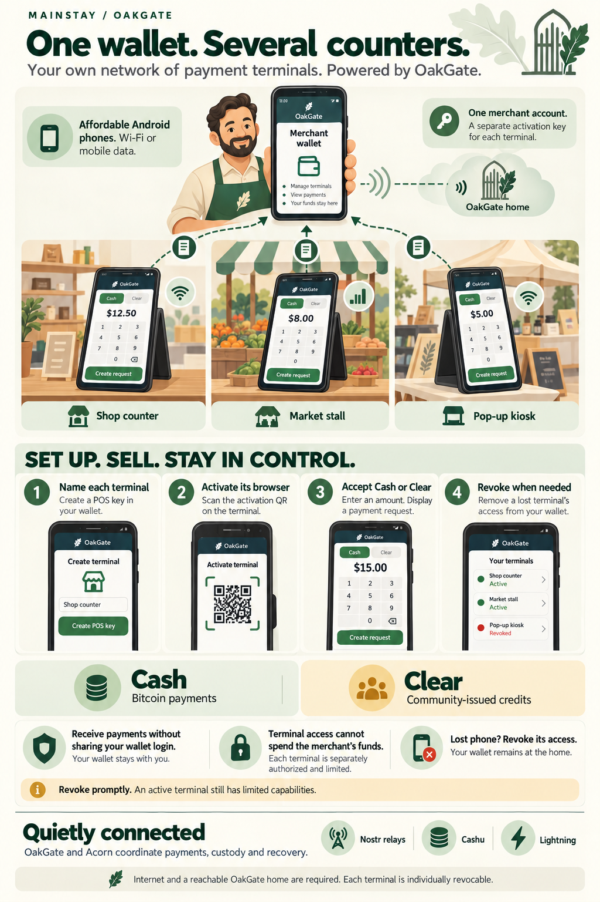
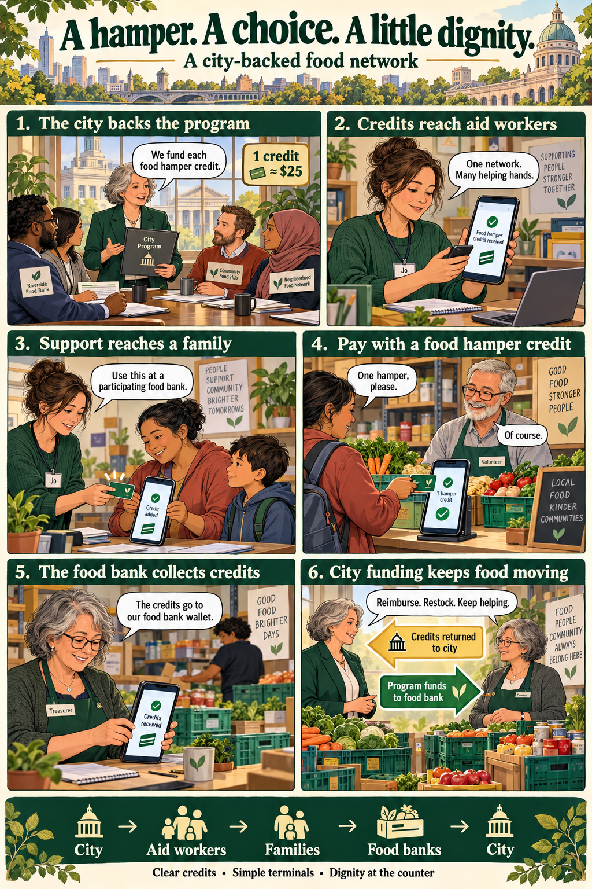
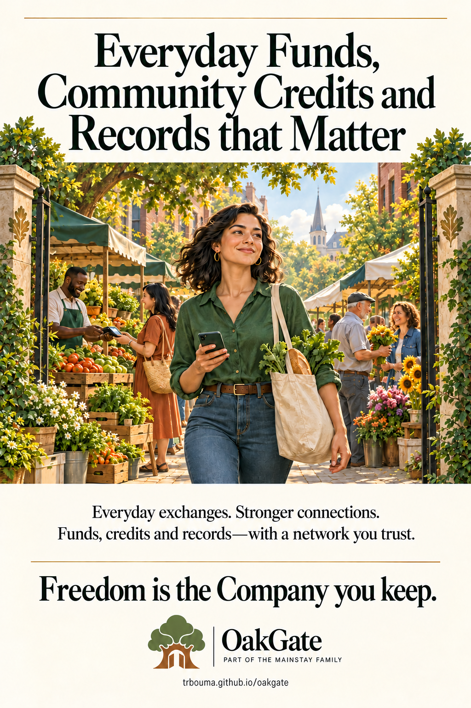

# User Experiences

What does OakGate feel like to use? These illustrated stories follow people
through everyday moments, with the technology explained only where it helps.
The characters and settings are illustrative; the accompanying notes distinguish
current features from future possibilities.

[Watch the video shorts →](video-shorts.md){ .md-button .md-button--primary }

<article class="oakgate-experience-preview" markdown>

## Meet Project OakGate

Leah starts with familiar sign-in, Funds and Records. Discover how the custodial
version of Safebox wraps convenience around safebox-acorn, with a path to
individual independence built into its direction.

[Start here →](meet-project-oakgate.md){ .md-button .md-button--primary }

</article>

<article class="oakgate-experience-preview" markdown>

## From a wallet to a card

At a community café, Maya pairs her wallet with the counter terminal, approves
her own card, pays with a tap, and presents a record at the terminal. Her phone doesn't need to write NFC cards—the
terminal takes care of that.

[Follow the experience →](card-pairing-and-payments.md){ .md-button .md-button--primary }

</article>

<article class="oakgate-experience-preview" markdown>

## One wallet, several counters

Sam equips his shop and market kiosks with affordable Android phones. Each
accepts Everyday Funds or Community Credits into his wallet, with its own activation and revocation.
Staff can collect payments and request customer record presentations without
receiving his wallet login.

[Follow the experience →](one-wallet-several-counters.md){ .md-button .md-button--primary }

</article>

<article class="oakgate-experience-preview" markdown>

## A day at the beach

Kai leaves her phone behind. Her bracelet lets her show resort membership, pay
for surfing and present emergency information with a contact-wallet access notice.

[Follow the experience →](a-day-at-the-beach.md){ .md-button .md-button--primary }

</article>

<article class="oakgate-experience-preview" markdown>

## A hamper. A choice. A little dignity.

A city funds food hamper credits. Aid workers distribute them, families pay at
participating food banks, and treasurers redeem the credits to keep food moving.
Follow one family's experience of support without another personal interview at
the counter.

[Follow the experience →](food-hamper-network.md){ .md-button .md-button--primary }

</article>

<article class="oakgate-experience-preview" markdown>

## Ad example

Everyday Funds, Community Credits and Records that Matter. A full-page advertising
concept about everyday exchanges, community and the company we keep.

[View the ad →](ad-example.md){ .md-button .md-button--primary }

</article>
